<div align="center">

# Hearthwork

**A cozy multiplayer pixel town where verified focus time earns coins for decorating your home.**

Sit down at a café table next to other people, start a Pomodoro, and every minute you actually
spend focused turns into coins for furniture, a garden and a bigger house.

[](https://github.com/AnasSAV/Focus-Town/actions/workflows/ci.yml)


**[Play it at hearthwork.anas-hussaindeen.com](https://hearthwork.anas-hussaindeen.com)**

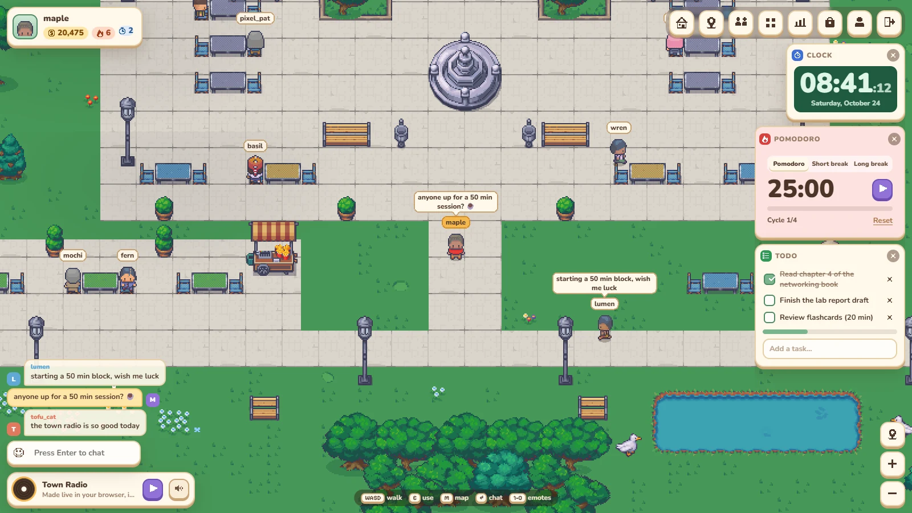

</div>

## Contents

- [Features](#features)
- [Screenshots](#screenshots)
- [How verified focus works](#how-verified-focus-works)
- [The economy](#the-economy)
- [Architecture](#architecture)
- [Getting started](#getting-started)
- [Controls](#controls)
- [Project structure](#project-structure)
- [Scripts](#scripts)
- [Testing and quality](#testing-and-quality)
- [Town editor](#town-editor)
- [Deployment](#deployment)
- [Documentation](#documentation)
- [Credits](#credits)

## Features

**Study together**

- A shared pixel town with a study plaza, café terrace, park, library and pond. Players walk
  around, chat, whisper and send emotes in real time.
- Sit at any table and press <kbd>E</kbd> to focus. People at the same table share one group
  Pomodoro and see each other's timers.
- 25- and 50-minute blocks, an optional audio-only mode, and a "still here?" check every 25
  minutes.

**Earn and build**

- Every verified minute earns coins, with a streak bonus for focusing on consecutive days and a
  bonus for finishing a block.
- A furniture shop with 68 items: furniture, decor, plants, wallpapers, floors and garden pieces.
- Every player has a home with a front yard. Decorate the inside and the garden, upgrade to
  bigger houses and more rooms, and invite friends to move in as housemates.
- Visit friends' and public homes from the world map, and study at their desks and garden
  tables too.

**Feel at home**

- A living world: canopies sway, birds flock, butterflies circle the flower beds, clouds cast
  shadows, fireflies come out after dark, and the light follows your local time of day.
- Floating widgets: clocks, a Pomodoro timer, a todo list, notes and a radio that plays the
  synced Town Radio or live lofi streams.
- Character creator, focus stats (minutes per day, streak calendar), a minimap, adjustable
  zoom, and iris transitions between homes and town.

**Built to be trusted**

- The server is the only source of truth for time and coins. Clients send intents, never
  durations, prices or amounts.
- Coins only change inside Postgres functions, and every change writes a ledger row in the
  same transaction. A nightly job checks every balance against its ledger.

## Screenshots

<table>
  <tr>
    <td width="50%">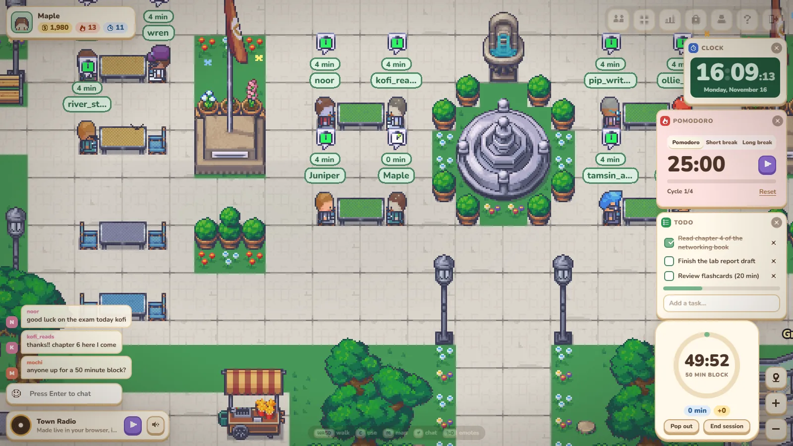<br><sub><b>Focus mode.</b> The verified timer, a group table and your widgets; the rest of the interface fades back.</sub></td>
    <td width="50%">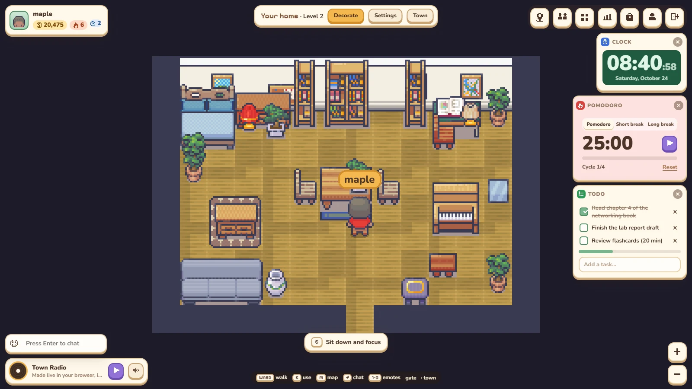<br><sub><b>Your home.</b> Furniture bought with focus coins, placed with the in-game editor.</sub></td>
  </tr>
  <tr>
    <td>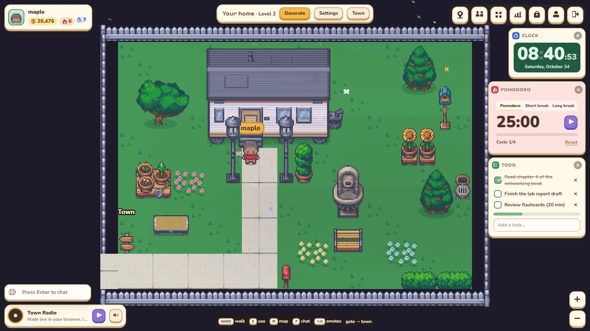<br><sub><b>The yard.</b> Gardens are decorated the same way; the signpost leads to town.</sub></td>
    <td>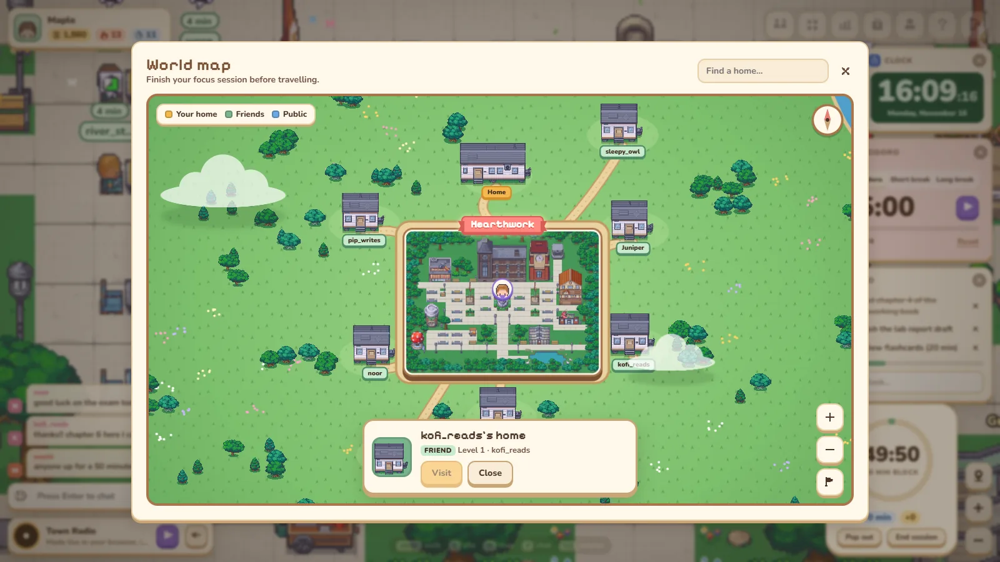<br><sub><b>World map.</b> Your home, friends' homes and public homes around the town. Pick one to visit.</sub></td>
  </tr>
  <tr>
    <td>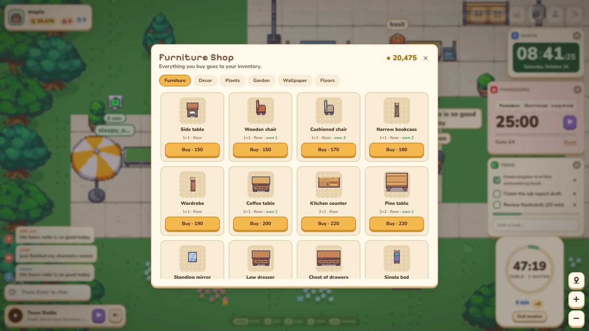<br><sub><b>Furniture shop.</b> Prices live in the database and are only ever read by SQL.</sub></td>
    <td>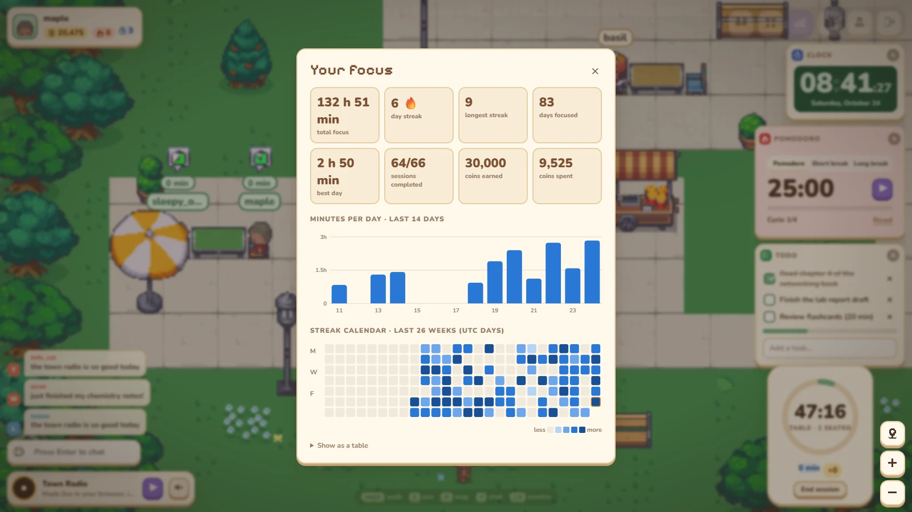<br><sub><b>Stats.</b> Totals, minutes per day and a 26-week streak calendar.</sub></td>
  </tr>
  <tr>
    <td>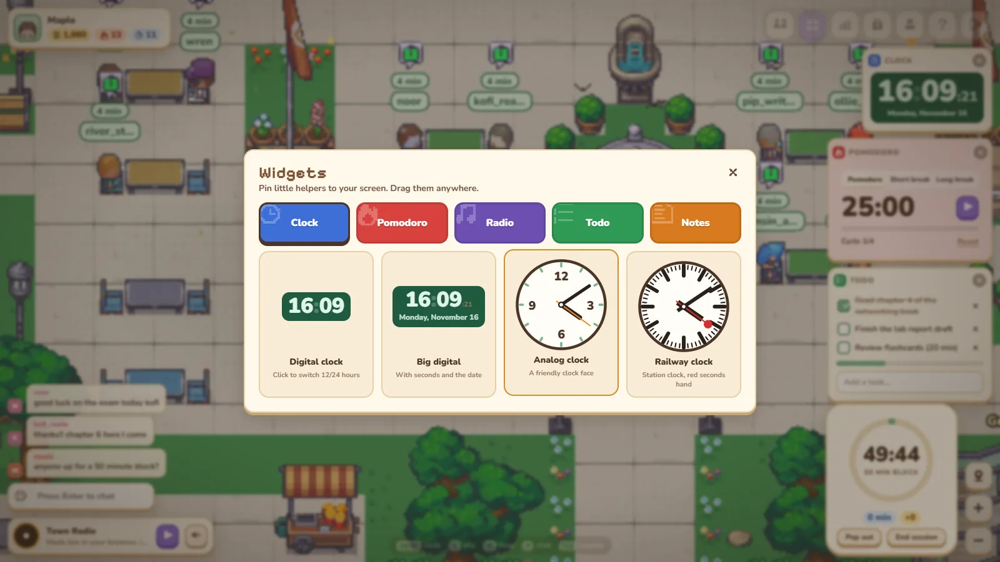<br><sub><b>Widgets.</b> Clocks, Pomodoro, radio, todo and notes. Drag them anywhere.</sub></td>
    <td>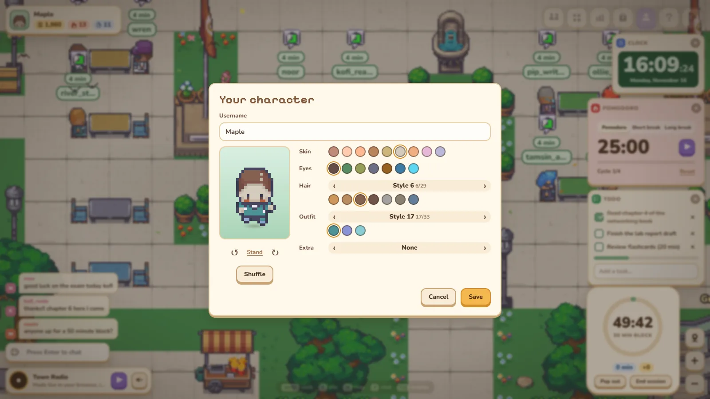<br><sub><b>Character creator.</b> Skin, eyes, 29 hairstyles, 33 outfits and accessories.</sub></td>
  </tr>
</table>

<div align="center">
  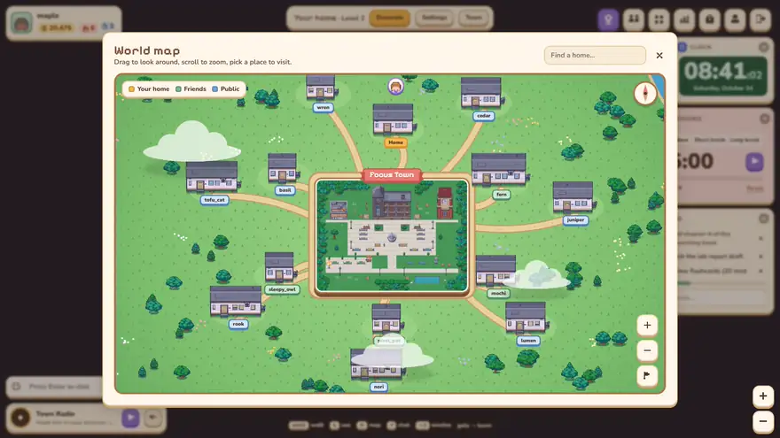<br>
  <sub>Travelling from home to town.</sub>
</div>

## How verified focus works

A minute only counts if the server saw it happen. The client sends a heartbeat once a minute;
the server, which owns the clock, decides whether that minute is verified.

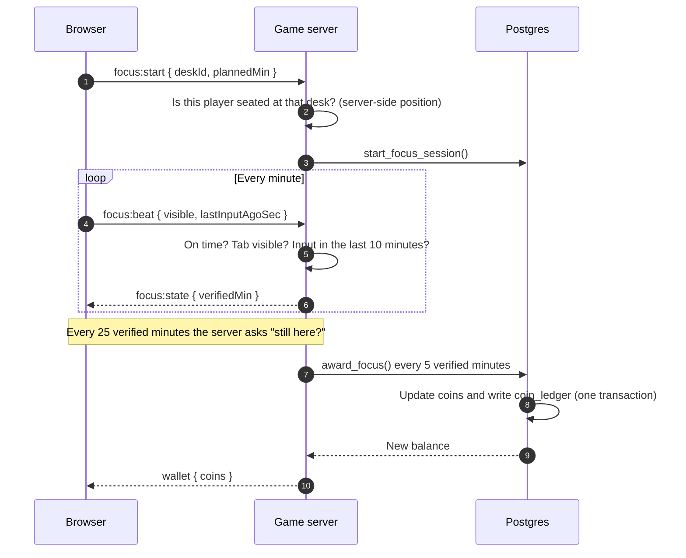

| Rule                | Value                                                                    |
| ------------------- | ------------------------------------------------------------------------ |
| Heartbeat           | Every 60 s. Earlier than 50 s is ignored; later than 80 s isn't counted  |
| Tab must be visible | Unless the player chose audio-only                                       |
| Recent input        | Keyboard or mouse used in the last 10 minutes                            |
| Presence check      | "Still here?" every 25 verified minutes                                  |
| Missed beats        | 3 missed heartbeats end the session                                      |
| Daily cap           | 480 rewarded minutes per UTC day                                         |
| Persistence         | Awarded every 5 minutes, so a server restart loses at most a few minutes |

The rules are pure functions in [`shared/src/focus.ts`](shared/src/focus.ts), unit-tested with
an injected clock.

## The economy

- **Base rate:** 1 coin per verified minute.
- **Streak bonus:** +5% for each consecutive day you focus, up to +50% after 10 days.
- **Completion bonus:** +5 coins for finishing a 25-minute block, +12 for a 50-minute block.
- **Upgrades:** a level-2 home (12×8 tiles) costs 1,500 coins and needs 20 hours of total
  focus. Level 3 adds a second room for 5,000 coins and 80 hours.

How long things take at the base rate, before any bonuses:

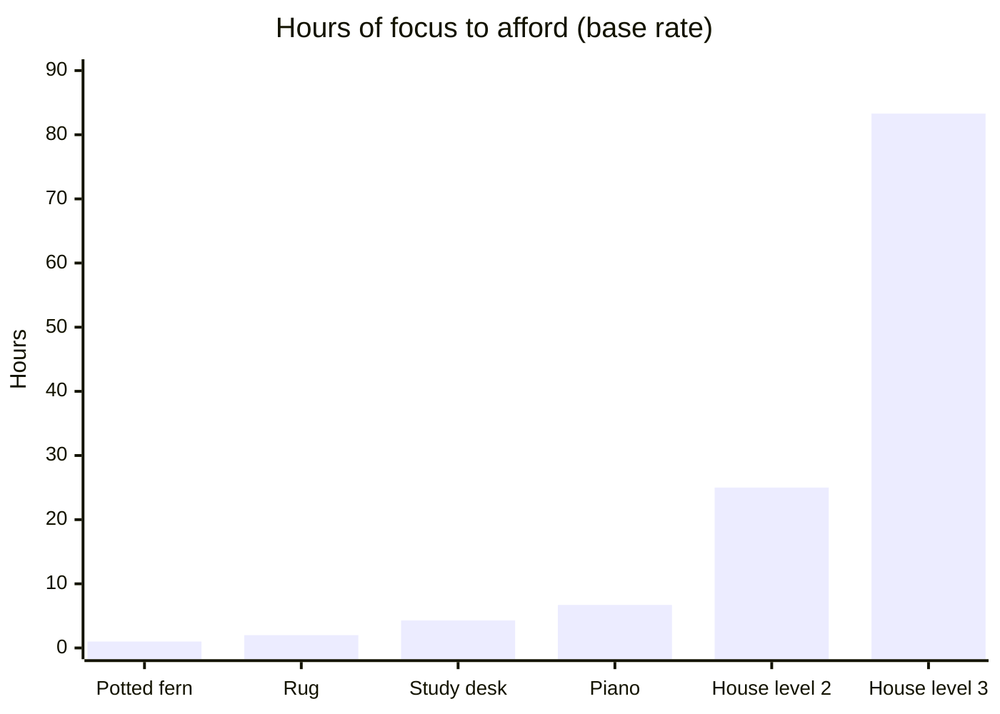

Prices are defined in [`shared/src/catalog.ts`](shared/src/catalog.ts) and seeded into the
database. The server and SQL read prices from there; a client can't send one.

## Architecture

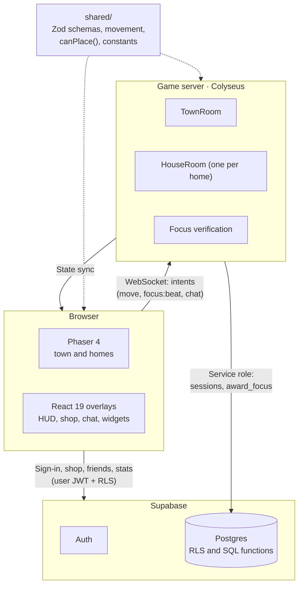

- **Authoritative movement.** Clients predict their own movement with the same collision code
  the server uses (`shared/src/movement.ts`). The server checks speed and walls and corrects
  anything impossible.
- **Every message validated.** Each client message is parsed with a Zod schema from `shared/`;
  invalid messages are rejected and logged.
- **Stateless game server.** Nothing important lives only in server memory, so the host can
  restart at any time. Sessions and coins are in Postgres.
- **The database enforces the rules.** Buying, saving a layout and upgrading are SQL functions
  that re-check ownership, prices and placement. `save_layout` mirrors `canPlace()` from
  `shared/src/house.ts`.

More diagrams (rooms, data model, security model) are in
[docs/ARCHITECTURE.md](docs/ARCHITECTURE.md).

### Tech stack

| Layer          | Choice                                                                                   |
| -------------- | ---------------------------------------------------------------------------------------- |
| Game rendering | [Phaser 4](https://phaser.io) on WebGL, 16×16 pixel art                                  |
| UI             | React 19 overlays over the canvas, Vite 7                                                |
| Multiplayer    | [Colyseus 0.18](https://colyseus.io), `@colyseus/schema` v5 state sync                   |
| Data and auth  | [Supabase](https://supabase.com): Postgres, Row Level Security, email and Google sign-in |
| Validation     | Zod 4 schemas shared by client and server                                                |
| Maps           | Tiled JSON, plus a custom [town editor](#town-editor)                                    |
| Tooling        | TypeScript 6 (strict), ESLint, Prettier, Vitest, GitHub Actions                          |
| Art            | [LimeZu](https://limezu.itch.io) Modern Interiors and Modern Exteriors                   |

## Getting started

### Prerequisites

- Node 22 or newer (developed on Node 24; see `.node-version`)
- Docker, for the local Supabase stack
- The [Supabase CLI](https://supabase.com/docs/guides/cli)

### Run it locally

```bash
git clone https://github.com/AnasSAV/Focus-Town.git
cd Focus-Town
npm install
supabase start      # Postgres, Auth and the REST API in Docker
```

Copy the keys that `supabase start` prints into `server/.env` and `client/.env` (start from
the `.env.example` files; [docs/SETUP.md](docs/SETUP.md) walks through it, including Google
sign-in). Then:

```bash
npm run dev         # game server on :2567, client on http://localhost:5173
```

Sign up, create a character and choose where to live. You start in your yard. Walk up into
the front door to go inside, or out of the garden gate (or open the map with <kbd>M</kbd>) to
go to town. Open a second browser or a private window with another account to see two
players.

## Controls

| Key                               | Action                                 |
| --------------------------------- | -------------------------------------- |
| <kbd>W A S D</kbd> / arrow keys   | Walk                                   |
| <kbd>E</kbd>                      | Sit and focus, open the shop door, use |
| <kbd>M</kbd>                      | World map                              |
| <kbd>Enter</kbd>                  | Chat                                   |
| <kbd>1</kbd>–<kbd>0</kbd>         | Emotes                                 |
| <kbd>I</kbd>                      | Inventory                              |
| <kbd>+</kbd> <kbd>−</kbd> / wheel | Zoom                                   |

At home, **Decorate** places furniture inside and garden items in the yard. **Settings**
manages housemates, visitors, the exterior and upgrades.

## Project structure

```
client/     Phaser scenes (TownScene, HouseScene), React UI, house editor, networking
server/     Colyseus rooms (TownRoom, HouseRoom), focus verification, Supabase access
shared/     Zod message schemas, Colyseus state, movement and collision, catalog,
            canPlace() and house geometry, focus rules, constants
supabase/   SQL migrations, seed data and SQL integration tests
tools/      Art and map builders (Python), the town editor, bots and end-to-end tests
deploy/     PM2 and Caddy configs for a VM; render.yaml for Render is at the root
docs/       Spec, architecture, decisions, setup and deployment guides
```

`shared/` is consumed as TypeScript source by both the client (Vite) and the server (tsx), so
there is no build step between them.

## Scripts

| Command                           | What it does                                                          |
| --------------------------------- | --------------------------------------------------------------------- |
| `npm run dev`                     | Server (tsx watch) and client (Vite) together                         |
| `npm run build`                   | Server bundle (`server/dist`) and client static build (`client/dist`) |
| `npm run typecheck`               | `tsc` for every workspace, `tools/` and the town editor               |
| `npm run lint` / `npm run format` | ESLint / Prettier                                                     |
| `npm test`                        | Vitest unit tests                                                     |
| `npm run test:db`                 | SQL integration tests against local Supabase                          |
| `npm run smoke`                   | Two bots join a running server and check sync, speed and wall checks  |
| `npm run e2e:house`               | Decorate, visit, study at a friend's desk, go private, upgrade        |
| `npm run e2e:focus`               | A real 6½-minute focus session through the running server             |
| `npm run load -- --bots 30`       | Load test: signed-in bots walking and chatting                        |
| `npm run check:ledger`            | Verify every balance equals its coin ledger                           |
| `npm run editor`                  | Town editor on http://127.0.0.1:5180 (local only)                     |
| `npm run map:town -- <pack dir>`  | Rebuild the town map and tileset from the LimeZu packs                |
| `npm run art:characters -- <dir>` | Rebuild the character part atlases                                    |
| `npm run art:interiors -- <dir>`  | Rebuild furniture and room sprites                                    |
| `npm run art:ui -- <dir>`         | Rebuild emote, timer and typing bubbles                               |
| `npm run seed:items`              | Regenerate `supabase/seed.sql` from `shared/src/catalog.ts`           |

## Testing and quality

| Layer         | What is covered                                                                                   |
| ------------- | ------------------------------------------------------------------------------------------------- |
| Unit (Vitest) | Focus verification, movement and collision, furniture placement, chat filter, radio sync, avatars |
| Database      | Economy, shop, houses, homes and housemates as SQL integration tests                              |
| Smoke         | Two bots: state sync, speed and wall enforcement, chat filtering and rate limits                  |
| End-to-end    | A full home flow and a real verified focus session against a running server                       |
| Load          | Dozens of signed-in bots moving at real client rates                                              |
| Ledger        | Every `profiles.coins` equals the sum of its `coin_ledger` rows                                   |

[CI](.github/workflows/ci.yml) runs typecheck, lint, format, unit tests and the build on every
push. A second job starts a throwaway Supabase stack in Docker and runs the SQL tests and the
ledger check. Scheduled workflows back up the database nightly (encrypted), re-check the
ledger, and keep the free Supabase project awake.

## Town editor

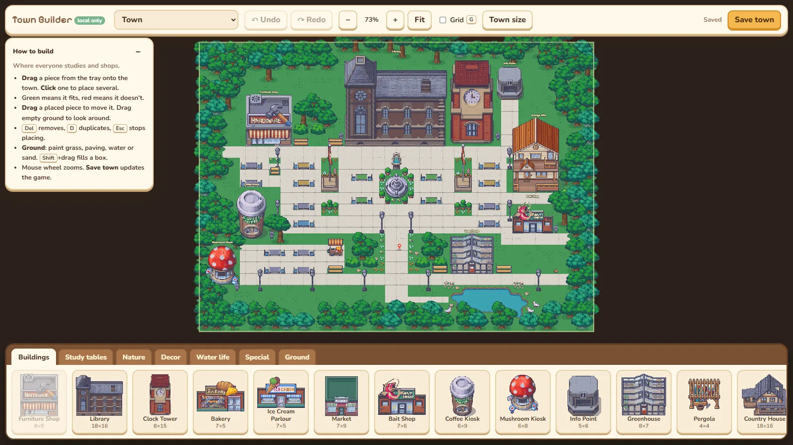

`npm run editor` opens a local-only layout editor for the town map (bound to 127.0.0.1,
never deployed). Select part of the town and drag it somewhere else along with its desks,
trees, walls and doors. You can also paint tiles and walls, place and edit desks, trees and
animations, and resize the map. Before saving, it checks that the spawn point is clear and
that every desk and door can be reached. Saving writes the Tiled JSON and `.tmx` and
regenerates the world-map picture; in development the game server reloads the new map
automatically. See [docs/SETUP.md](docs/SETUP.md#editing-the-town-optional).

## Deployment

The client is a static site and the game server is a single Node process.
[docs/DEPLOY.md](docs/DEPLOY.md) covers:

- **Supabase:** schema, auth settings and a connection string for backups.
- **Prototype:** the game server on Render and the client on Cloudflare Pages.
- **Launch:** the game server on an Oracle Cloud VM with PM2, and Caddy for HTTPS.
- **GitHub Actions:** the secrets for backups, the ledger check and keep-alive.

## Documentation

| Document                                     | What's in it                                                  |
| -------------------------------------------- | ------------------------------------------------------------- |
| [docs/SPEC.md](docs/SPEC.md)                 | The original product brief and phases                         |
| [docs/ARCHITECTURE.md](docs/ARCHITECTURE.md) | System, rooms, data model and security model                  |
| [docs/DECISIONS.md](docs/DECISIONS.md)       | Design decisions and deviations from the brief, by phase      |
| [docs/SETUP.md](docs/SETUP.md)               | Local setup, keys, Google sign-in, the editor, rebuilding art |
| [docs/DEPLOY.md](docs/DEPLOY.md)             | Production deployment                                         |
| [CONTRIBUTING.md](CONTRIBUTING.md)           | Workflow, checks and the rules every change must keep         |
| [SECURITY.md](SECURITY.md)                   | Reporting vulnerabilities and how secrets are handled         |

## Credits

Characters, town, houses and furniture are by [LimeZu](https://limezu.itch.io) (Modern
Interiors and Modern Exteriors), used under their license with credit. The packs themselves are
not in this repository; only derived atlases are. Fonts are
[Nunito](https://fonts.google.com/specimen/Nunito) and
[Pixelify Sans](https://fonts.google.com/specimen/Pixelify+Sans) (SIL OFL). Full details are in
[CREDITS.md](CREDITS.md).

No open-source license has been chosen for this repository, so all rights are reserved by the
author. The LimeZu art is covered by its own license and may not be redistributed separately.
