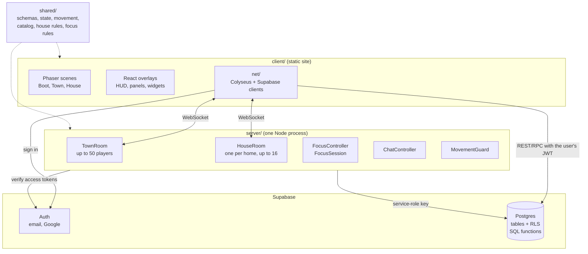
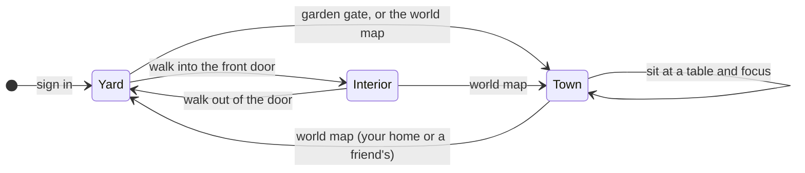
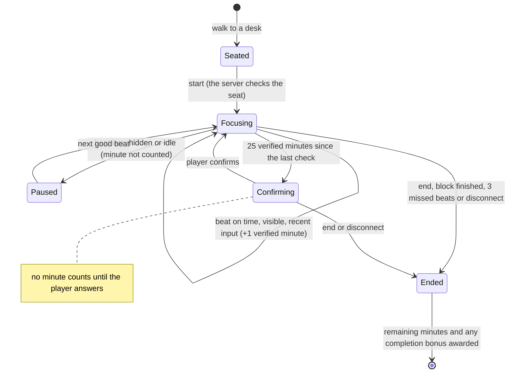
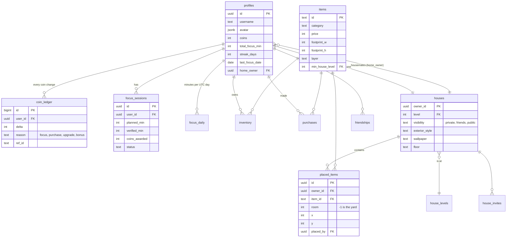
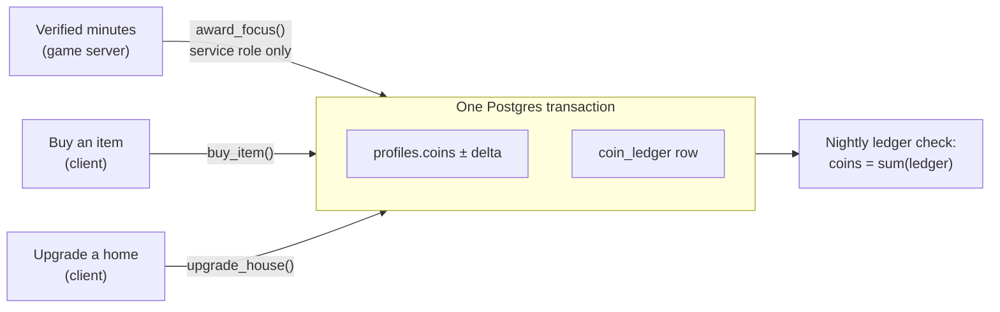

# Architecture

How Focus Town fits together: the processes, the rooms players move between, the messages they
send, the data model, and who is allowed to change what. For the reasoning behind individual
choices, see [DECISIONS.md](DECISIONS.md).

- [System overview](#system-overview)
- [Worlds and rooms](#worlds-and-rooms)
- [Messages](#messages)
- [Movement](#movement)
- [Focus sessions](#focus-sessions)
- [Data model](#data-model)
- [How coins move](#how-coins-move)
- [Security model](#security-model)
- [Hosting](#hosting)

## System overview

- The **client** renders the worlds with Phaser and draws every panel with React on top of
  the canvas. It talks to the game server over WebSockets for anything live (movement, chat,
  focus), and directly to Supabase for account-level actions (sign-in, shop, friends, stats,
  saving a layout). Those actions are protected by Row Level Security and SQL functions.
- The **game server** is authoritative for positions, seating and focus time. It verifies
  each player's Supabase access token when they join a room and uses the service-role key for
  the few functions only it may call.
- **`shared/`** holds everything both sides must agree on: Zod message schemas, the Colyseus
  state schema, movement and collision, the item catalog, furniture placement rules and the
  focus verification rules.

## Worlds and rooms

There is one town and one home per household. Each world is a Phaser scene backed by its own
Colyseus room; travelling leaves one room and joins the other behind an iris transition.

| Room        | Instances         | State it syncs                                                        |
| ----------- | ----------------- | --------------------------------------------------------------------- |
| `TownRoom`  | One (50 players)  | Players (position, facing, avatar, status, typing), the town clock    |
| `HouseRoom` | One per home (16) | Players, the home's level and size, placed furniture and garden items |

A home is a single world: the yard (20×14 tiles) on the left and the interior rooms to the
right, far enough apart that the camera never shows one from the other. The door is a portal
the server validates (`house:door`).

## Messages

Every client message is parsed with its Zod schema from `shared/src/schemas.ts` before a room
handles it. Invalid messages are dropped and logged.

| Client → server                  | Purpose                                                     |
| -------------------------------- | ----------------------------------------------------------- |
| `move`                           | Predicted position, facing and whether the player is moving |
| `focus:start` / `focus:end`      | Start a session at a desk, or end it                        |
| `focus:beat` / `focus:confirm`   | Once-a-minute heartbeat; answer to "still here?"            |
| `chat`, `whisper`, `chat:report` | Room chat, private messages, reporting a message            |
| `emote`, `typing`                | Emote bubbles and the typing indicator                      |
| `house:door`, `house:reload`     | Go through the front door; reload after editing the layout  |
| `profile:reload`                 | Pick up a changed name or avatar                            |

| Server → client                                  | Purpose                                    |
| ------------------------------------------------ | ------------------------------------------ |
| `move:correct`                                   | Snap back after an impossible move         |
| `wallet`                                         | Current coins after an award or a purchase |
| `focus:state`, `focus:ended`, `focus:error`      | Verified minutes, results, refusals        |
| `chat`, `chat:history`, `chat:notice`, `whisper` | Chat delivery                              |
| `emote`, `clock`, `house:notice`                 | Emotes, the synced clock, home events      |

## Movement

Clients move immediately (prediction) using `stepMovement()` and the collision grid from
`shared/src/movement.ts`, and send their position ten times a second. The server's
`MovementGuard` replays the same rules:

- The distance covered may not exceed the player speed × elapsed time (with a small
  tolerance and a capped time credit, so a stalled client can't teleport later).
- Feet may not overlap a solid tile.
- Seated players can't move.

Anything else is answered with `move:correct`, and the client snaps back. The town's
collision grid comes from the Tiled map; homes build theirs from the walls and the placed
furniture (`houseCollisionGrid()` in `shared/src/house.ts`).

## Focus sessions

`FocusSession` keeps the verification state for one player (`shared/src/focus.ts` holds the
pure rules) and flushes verified minutes to `award_focus()` every 5 minutes, and once more at
the end. If the server restarts, `abandon_active_sessions()` closes what was left open; at most
the last few unflushed minutes are lost.

People seated at the same group table share one Pomodoro: the first person to sit starts it,
and everyone else joins its cycle.

## Data model

Also: `focus_daily` (minutes and rewarded minutes per day, for the daily cap and stats),
`house_levels` (size, rooms, cost and required focus per level), `friendships`,
`house_invites` (move-in requests and invitations) and `chat_reports`.

## How coins move

- `award_focus()` applies the streak multiplier and the daily cap and writes `focus` and
  `bonus` ledger rows.
- `buy_item()` reads the price from `items`, is idempotent per request id (a retried request
  never charges twice), and adds the item to the inventory.
- `upgrade_house()` checks the next level's coin cost and required focus hours.

No other code path changes `profiles.coins`. `ledger_mismatches()` (run by
`npm run check:ledger`, CI and a nightly workflow) lists anyone whose balance doesn't equal
the sum of their ledger.

## Security model

| Actor          | Credentials                      | May do                                                                                                          |
| -------------- | -------------------------------- | --------------------------------------------------------------------------------------------------------------- |
| Browser        | Anon key + the user's JWT        | Read what RLS allows; call player functions (`buy_item`, `save_layout`, `upgrade_house`, friends, homes, stats) |
| Game server    | Service-role key (`server/.env`) | Verify tokens; start, award and end focus sessions; check visiting rights                                       |
| CI / workflows | Repository secrets               | Backups (encrypted), ledger checks, keep-alive                                                                  |

- Functions are `security definer` with an empty `search_path`; `execute` is revoked from
  everyone and granted only to the role that needs it. `award_focus`, `start_focus_session`
  and `end_focus_session` are granted to `service_role` only.
- The service-role key is never imported by client code and never committed; only
  `.env.example` files are in the repository.
- Visiting a home goes through `can_visit()` (owner, housemates, friends for friends-only
  homes, anyone for public homes).
- Chat is filtered and rate-limited on the server, and can be reported.

## Hosting

The design assumes free tiers that restart and sleep:

- The game server keeps nothing important only in memory. A restart costs players a reconnect
  (20 s grace) and at most a few unflushed focus minutes.
- The town map is bundled into the server build, so the server reads no files at runtime.
- A daily workflow keeps the Supabase project from pausing; nightly workflows back it up and
  check the ledger.

Deployment steps are in [DEPLOY.md](DEPLOY.md).
